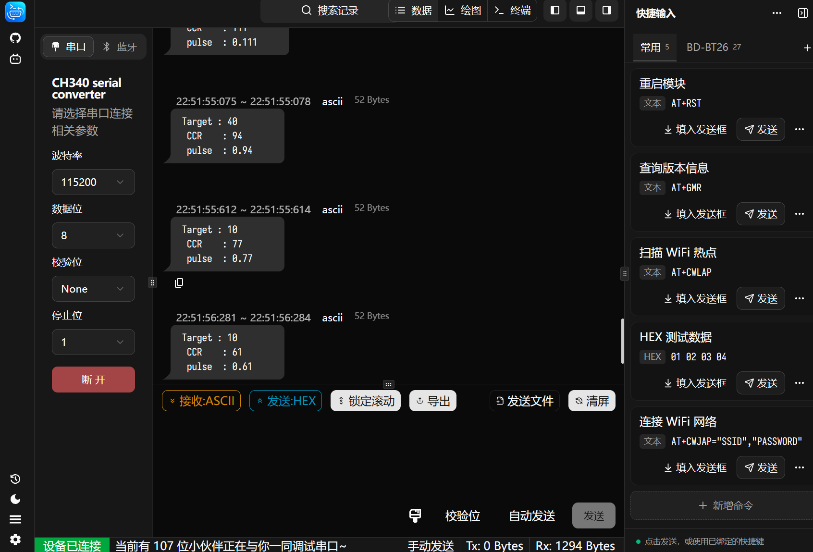

# 电控培训第四次作业
**蒋赛毅**
***20263001721***  

推导公式：
计数频率 f_cnt = f_TIM / (PSC + 1)
PWM周期 T_PWM = (PSC + 1) × (ARR + 1) / f_TIM

舵机标准周期 T_PWM = 20ms，变形：
(PSC + 1) × (ARR + 1) = f_TIM × 0.02

本项目定时器时钟 f_TIM = 72MHz
代入计算：(PSC + 1) × (ARR + 1) = 1440000

参数解释：
1. PSC = 71
实际分频系数 PSC+1 = 72，计数频率 = 72MHz / 72 = 1MHz，1个计数值对应1μs，方便脉冲宽度计算。
2. ARR = 19999
一个周期计数总量 ARR+1 = 20000，PWM周期 = 20000 × 1μs = 20ms，满足舵机50Hz驱动要求。
